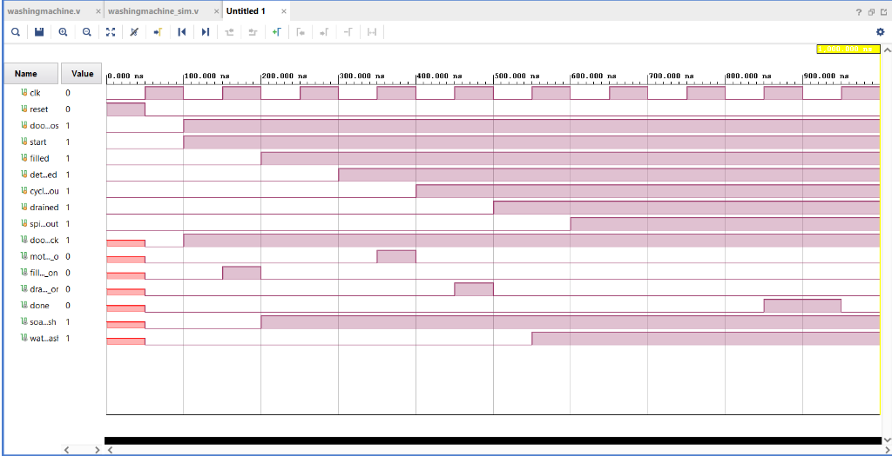

# FSM-Based Automatic Washing Machine Controller in Verilog HDL 🧺

[](https://en.wikipedia.org/wiki/Verilog)
[](https://www.xilinx.com/)
[](LICENSE)
[]()

An FPGA/ASIC-synthesizable digital controller for an automatic washing machine modeled as a **Finite State Machine (FSM)** in **Verilog HDL**. 

The controller orchestrates the end-to-end wash cycle, including door safety interlocks, automated water intake, detergent dispensing, bidirectional motor agitation, water drainage, and high-speed spin extraction.

---

## 👨‍💻 Project Overview

* **Design Type:** Synchronous Finite State Machine (FSM)
* **HDL Language:** Verilog HDL
* **Simulation & Synthesis:** Xilinx Vivado, ModelSim, Icarus Verilog + GTKWave

---

## 📸 Simulation Waveform

<p align="center">
  
  <br>
  <sub>🔍 <em>Full functional simulation waveform showing state transitions from Idle/Check Door through Spin and Done.</em></sub>
</p>

---

## ⚙️ FSM States & State Encoding

The controller operates as a 3-bit synchronous state machine with 6 distinct operating states:

| State Parameter | Binary Code | State Name | Description |
|---|:---:|---|---|
| `check_door` | `3'b000` | Idle / Door Check | Waits for user `start` command and verifies `door_close == 1`. |
| `fill_water` | `3'b001` | Water Filling | Activates water inlet valve (`fill_value_on = 1`) until `filled == 1`. |
| `add_detergent` | `3'b010` | Detergent Add | Dispenses detergent soap wash (`soap_wash = 1`) until `detergent_added == 1`. |
| `cycle` | `3'b011` | Agitation / Wash | Runs motor agitation (`motor_on = 1`) until wash timer expires (`cycle_timeout == 1`). |
| `drain_water` | `3'b100` | Drainage | Opens drain valve (`drain_value_on = 1`) until drum is empty (`drained == 1`). |
| `spin` | `3'b101` | Spin Drying | Activates high-speed spin extractor until `spin_timeout == 1`, then signals `done = 1`. |

---

## 🔄 State Transition Flow

```text
                  +--------------------------+
                  |  check_door (3'b000)     |<-----------------+
                  |  (start & door_close)    |                  |
                  +-------------+------------+                  |
                                |                               |
                                v                               |
                  +--------------------------+                  |
                  |  fill_water (3'b001)     |                  |
                  |  (fills until filled=1)  |                  |
                  +-------------+------------+                  |
                                |                               |
                                v                               |
                  +--------------------------+                  |
                  |  add_detergent (3'b010)  |                  |
                  |  (soap_wash=1)           |                  |
                  +-------------+------------+                  |
                                |                               |
                                v                               |
                  +--------------------------+                  |
                  |  cycle (3'b011)          |                  |
                  |  (motor_on=1 agitation)  |                  |
                  +-------------+------------+                  |
                                |                               |
                                v                               |
                  +--------------------------+                  |
                  |  drain_water (3'b100)    |                  |
                  |  (drain_value_on=1)      |                  |
                  +-------------+------------+                  |
                                |                               |
                +---------------+---------------+               |
                | (if water_wash == 0)          | (if rinsed)   |
                v                               v               |
         [Refill Water]           +--------------------------+  |
         (Rinse Cycle)            |  spin (3'b101)           |  |
                                  |  (spin_timeout -> done=1)|--+
                                  +--------------------------+
```

---

## 🔌 Port Specifications

### Input Signals
| Signal Name | Width | Type | Description |
|---|:---:|:---:|---|
| `clk` | 1-bit | Clock | Master system clock input. |
| `reset` | 1-bit | Reset | Asynchronous active-high system reset. |
| `door_close` | 1-bit | Sensor | Safety interlock sensor indicating door lid is securely shut. |
| `start` | 1-bit | User Input | User pushbutton/switch to initiate the washing cycle. |
| `filled` | 1-bit | Sensor | Water level pressure switch indicating tub is filled. |
| `detergent_added` | 1-bit | Sensor | Detergent compartment sensor indicating soap release. |
| `cycle_timeout` | 1-bit | Timer | Internal timer signal indicating wash agitation duration elapsed. |
| `drained` | 1-bit | Sensor | Sump/drain sensor confirming water evacuation complete. |
| `spin_timeout` | 1-bit | Timer | High-speed spin drying duration complete. |

### Output Signals
| Signal Name | Width | Type | Description |
|---|:---:|:---:|---|
| `door_lock` | 1-bit | Actuator | Solenoid door lock latch (active during water and motor stages). |
| `motor_on` | 1-bit | Actuator | Main motor drive enable for drum agitation. |
| `fill_value_on` | 1-bit | Actuator | Solenoid water inlet valve control. |
| `drain_value_on` | 1-bit | Actuator | Drain pump relay / valve control. |
| `done` | 1-bit | Status | Cycle completion indicator (triggers buzzer/LED). |
| `soap_wash` | 1-bit | Status | Status flag indicating detergent wash phase. |
| `water_wash` | 1-bit | Status | Status flag indicating clean water rinse phase. |

---

## 📂 Repository Structure

```text
Washing-machine-controller-/
├── .gitignore                          # EDA simulation temporary files ignore
├── LICENSE                             # MIT Open Source License
├── README.md                           # Main documentation & technical reference
├── sim/
│   └── automatic_washing_machine_tb.v  # Full functional testbench with stimulus
├── src/
│   └── automatic_washing_machine.v     # Verilog RTL FSM design module
└── docs/
    └── images/
        └── simulation_waveform.png     # Vivado/ModelSim verification waveform
```

---

## 🚀 How to Run Simulation

### Option A: Using Icarus Verilog & GTKWave (Open Source)
```bash
# Clone the repository
git clone https://github.com/shivamdubey733/Washing-machine-controller-.git
cd Washing-machine-controller-

# Compile design and testbench
iverilog -o sim_out src/automatic_washing_machine.v sim/automatic_washing_machine_tb.v

# Run simulation
vvp sim_out
```

### Option B: Using Xilinx Vivado
1. Launch Vivado and create a new project.
2. Add `src/automatic_washing_machine.v` as a **Design Source**.
3. Add `sim/automatic_washing_machine_tb.v` as a **Simulation Source**.
4. Click **Run Simulation > Run Behavioral Simulation**.
5. View waveforms matching `docs/images/simulation_waveform.png`.

### Option C: Using ModelSim / QuestaSim
```tcl
vlib work
vlog src/automatic_washing_machine.v sim/automatic_washing_machine_tb.v
vsim automatic_washing_machine_tb
add wave -r /*
run -all
```

---

## 📜 License

This project is open-source and distributed under the [MIT License](LICENSE).
